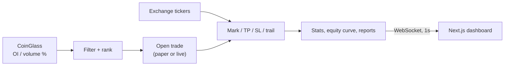

<div align="center">

# 🎯 OI Sniper

### Open-interest & volume screener with a paper-first trading engine

<p>
  
  
  
  
  
</p>

<p><b>Scan 400+ perpetuals</b> · <b>rank by OI / volume moves</b> · <b>trade with a full exit plan</b> · <b>watch it all live</b></p>

</div>

---

## ✨ What it does

| | |
|---|---|
| 🔍 **Screens the market** | Reads the full CoinGlass table and filters coins by open-interest and volume percentage moves across multiple timeframes. |
| ⚡ **Prices from real feeds** | Marks every coin from public exchange tickers: Binance, Bybit, Gate, KuCoin, MEXC and more. |
| 🧪 **Paper first** | Fills, fees, slippage and PnL are simulated by default. Live trading needs an explicit, confirmed switch. |
| 🛡️ **Guardrails built in** | Margin per trade, daily loss cap, max open positions, leverage clamp and a kill switch. |
| 📡 **Live workstation** | A dense dashboard fed by a one-second WebSocket stream, with polling as automatic fallback. |
| 🔐 **Locked down** | Bearer-token auth on every API route, timing-safe comparison, tokens kept out of client bundles. |

## 🧭 How it flows



## 🗂️ Project layout

```text
tradingbot/
├── 🖥️  dashboard/   Next.js 15 workstation UI
├── ⚙️  backend/     Trading engine, REST + WebSocket API (zero npm dependencies)
│   ├── src/        engine, venues, executors, store, vault
│   ├── scripts/    server entry point
│   └── test/       backend test suite
└── 📚 docs/        exchange notes and strategy reference
```

## 🚀 Quick start

**Requirements:** Node.js 20+.

```bash
# 1. Backend  (http://localhost:8000)
cd backend
npm start

# 2. Dashboard  (http://localhost:3000)
cd ../dashboard
npm install
echo "NEXT_PUBLIC_API_BASE=http://localhost:8000" > .env.local
npm run dev
```

The bot starts **paused** because filters are intentionally blank. Add at least one OI or volume row in the **Strategy** drawer, save, then press **Start**.

### ⚙️ Backend configuration

| Variable | Default | Purpose |
|---|---|---|
| `PORT` | `8000` | HTTP and WebSocket port |
| `HOST` | `0.0.0.0` | Bind address |
| `ADMIN_SECRET` | *(unset = open)* | Bearer token required on `/api/*` and `/ws` |
| `DATA_DIR` | `./data` | Where `state.json` is stored |
| `UPSTASH_REDIS_REST_URL` / `_TOKEN` | *(unset)* | Optional external state persistence |

> ⚠️ **Always set `ADMIN_SECRET`** before exposing the backend beyond your own machine.

## 🖥️ Dashboard tour

| Panel | Shows |
|---|---|
| **Topbar** | Mode, run/pause, scan, kill switch, panic, exchange |
| **Telemetry strip** | Signal latency, scrape and book age, loop lag, venue health |
| **KPI strip** | Equity, realised / unrealised PnL, win rate, profit factor, drawdown |
| **Scanner** | Ranked coins with OI and volume deltas, status and inspector |
| **Positions** | Open trades with lifecycle, TP/SL and one-click close |
| **CoinGlass feed** | Top movers from the flow table |
| **Equity chart** | Curve against starting fund |
| **Trades and logs** | History, CSV export and the activity stream |
| **Strategy drawer** | Long / short profiles, fees, slippage, live guardrails, backup |

Every panel has loading, empty and error states, and API calls time out after 20 seconds.

## 🔌 API at a glance

| Endpoint | Method | Auth |
|---|---|---|
| `/api/health` | GET | none |
| `/api/dashboard` | GET | bearer |
| `/ws?token=…` | WebSocket | token |
| `/api/*` (control, settings, exchanges, reports) | GET / POST | bearer |

## 🧪 Tests

```bash
cd backend   && npm test          # backend suite
cd dashboard && npm run type-check
```

## 📖 More docs

- 📘 [Strategy reference (v0)](docs/STRATEGY-REFERENCE.md): filters, exit plan and simulation details
- 🏦 [`docs/exchanges`](docs/exchanges): venue notes
- 🎨 [`DESIGN.md`](DESIGN.md): design language
- 📝 [`CHANGELOG.md`](CHANGELOG.md)

---

<div align="center">
<sub>Built for an internal team. Paper trading is the default; trade live only after you have tested your settings.</sub>
</div>
